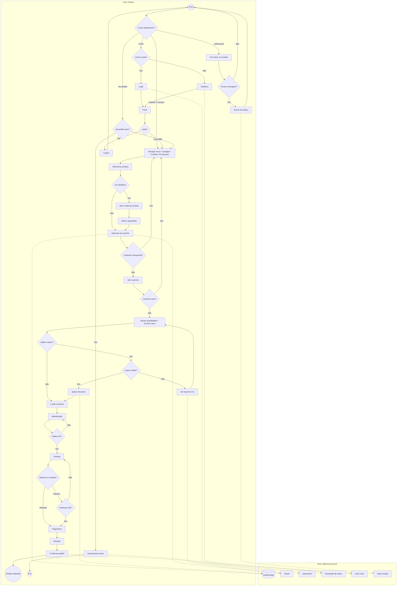
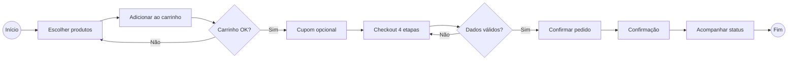

# Pixel Burguer — Documento BPMN e Processos

> **Versão visual (PDF):** abra [`BPMN.html`](./BPMN.html) e use **Ctrl+P → Salvar como PDF**,  
> ou execute [`gerar-bpmn-pdf.ps1`](./gerar-bpmn-pdf.ps1) para gerar `BPMN-Pixel-Burguer.pdf` automaticamente.

**Projeto:** Pixel Burguer (cardápio e pedidos online)  
**Escopo:** Aplicação front-end em `web2/` (React + Vite)  
**Data:** setembro/2026  

---

## 1. Visão geral

O Pixel Burguer é um site de lanchonete com tema gamer/arcade. O cliente navega pelo cardápio, monta o carrinho, finaliza o pedido em etapas e pode acompanhar o status (simulado). Login, cadastro e perfil existem de forma mockada (sem API real). Dados do carrinho e do usuário ficam no `localStorage` do navegador.

### Atores

| Ator | Papel |
|------|--------|
| **Cliente** | Navega, compra, autentica, envia contato, acompanha pedido |
| **Sistema (front-end)** | Valida formulários, persiste estado local, gera ID do pedido, simula status, exibe toasts |

### Processos principais

1. Navegação e consulta de cardápio  
2. Montagem do carrinho e aplicação de cupom  
3. Checkout e finalização do pedido  
4. Acompanhamento do pedido  
5. Autenticação e perfil  
6. Contato institucional  

---

## 2. Diagrama BPMN — visão completa

---

## 3. Processo detalhado — Pedido (P1)

### Objetivo

Permitir que o cliente escolha produtos, monte o carrinho e conclua um pedido com entrega ou retirada.

### Fluxo resumido

| Etapa | Atividade | Gateway / regra |
|-------|-----------|-----------------|
| 1 | Acessar Início, Cardápio, Combos ou Promoções | — |
| 2 | Selecionar produto (card ou modal) | Quantidade ≥ 1 no modal |
| 3 | Adicionar ao carrinho | Toast de sucesso; persiste em `localStorage` |
| 4 | Abrir carrinho | Se vazio → redireciona ao cardápio |
| 5 | Editar itens / cupom | Cupons: `PIXEL10`, `GAMER20`, `LEVEL50` |
| 6 | Checkout — Identificação | Nome, e-mail e telefone obrigatórios |
| 7 | Checkout — Entrega | Retirada **ou** endereço completo |
| 8 | Checkout — Pagamento | Pix, cartão ou dinheiro (somente seleção) |
| 9 | Checkout — Revisão e confirmação | `placeOrder` gera ID, limpa carrinho |
| 10 | Confirmação | Link para acompanhamento |

### Eventos de fim

- **Pedido finalizado** — tela `/confirmacao` com resumo  
- **Carrinho abandonado** — cliente sai sem checkout (não modelado como erro)

### Observações técnicas

- Não há gateway de pagamento real nem integração com cozinha.  
- Taxa de entrega fixa no front (`DELIVERY_FEE`).  
- Status do pedido após confirmação é simulado no cliente.

---

## 4. Processo — Acompanhamento (P2)

| Passo simulado | Label |
|----------------|--------|
| 0 | Pedido recebido |
| 1 | Preparando |
| 2 | Pronto |
| 3 | A caminho |
| 4 | Entregue |

O status avança a cada **8 segundos** no navegador. Se não houver `lastOrder` em memória, a tela informa que não há pedido ativo.

---

## 5. Processo — Autenticação (P3)

| Atividade | Comportamento atual |
|-----------|---------------------|
| Login | Aceita qualquer e-mail/senha preenchidos; grava usuário mock |
| Cadastro | Cria usuário local com nome, e-mail, telefone |
| Perfil | Abas: visão geral, pedidos (mock), endereços, config. |
| Logout | Remove usuário do `localStorage` e volta ao início |

**Gateway:** perfil exige usuário logado; caso contrário, CTA para login.

---

## 6. Processo — Contato (P4)

Cliente preenche formulário em `/contato` → sistema exibe toast de sucesso. **Não há envio real de e-mail ou ticket.**

---

## 7. Mapa de rotas (referência)

| Rota | Página | Processo |
|------|--------|----------|
| `/` | Home | P1 |
| `/cardapio` | Menu | P1 |
| `/combos` | Combos | P1 |
| `/promocoes` | Promoções | P1 |
| `/carrinho` | Carrinho | P1 |
| `/checkout` | Checkout | P1 |
| `/confirmacao` | Confirmação | P1 |
| `/acompanhar` | Tracking | P2 |
| `/login` | Login | P3 |
| `/cadastro` | Cadastro | P3 |
| `/perfil` | Perfil | P3 |
| `/sobre` | Sobre | Institucional |
| `/contato` | Contato | P4 |
| `*` | 404 | Exceção |

---

## 8. Diagrama BPMN — só o pedido (versão apresentação)

---

## 9. Limitações do modelo atual

- Sem pool de “Cozinha / Operação” real — status é fake no front.  
- Sem gateway financeiro.  
- Auth sem validação de credenciais no servidor.  
- Pedidos do perfil são dados estáticos mock.  
- Contato sem persistência.

Essas limitações alimentam o backlog em `docs/BACKLOG.md`.
