# Pixel Burguer — EAP (Estrutura Analítica do Projeto)

**Projeto:** Pixel Burguer — site de cardápio e pedidos  
**Tipo:** EAP / WBS (Work Breakdown Structure)  
**Orientação:** por entregas (produto + gestão)  
**Data:** setembro/2026 · **Versão:** 1.0  

A EAP decompõe o projeto em pacotes de trabalho gerenciáveis. Os códigos (`1.2.3`) permitem rastrear escopo, backlog e BPMN.

---

## 1. Diagrama da EAP

```mermaid
flowchart TB
  R["1. Pixel Burguer"]

  R --> A["1.1 Gestão do projeto"]
  R --> B["1.2 Produto — Front-end"]
  R --> C["1.3 Produto — Backend e operação"]
  R --> D["1.4 Qualidade e evidências"]
  R --> E["1.5 Documentação e entrega"]

  A --> A1["1.1.1 Planejamento"]
  A --> A2["1.1.2 Acompanhamento"]
  A --> A3["1.1.3 Encerramento"]

  B --> B1["1.2.1 Fundação técnica"]
  B --> B2["1.2.2 Catálogo e descoberta"]
  B --> B3["1.2.3 Carrinho e cupons"]
  B --> B4["1.2.4 Checkout e pedido"]
  B --> B5["1.2.5 Conta do cliente"]
  B --> B6["1.2.6 Institucional"]

  C --> C1["1.3.1 API e dados"]
  C --> C2["1.3.2 Auth e pedidos"]
  C --> C3["1.3.3 Pagamentos"]
  C --> C4["1.3.4 Painel operacional"]

  D --> D1["1.4.1 Testes"]
  D --> D2["1.4.2 Acessibilidade e UX"]
  D --> D3["1.4.3 CI e deploy"]

  E --> E1["1.5.1 Docs de produto"]
  E --> E2["1.5.2 Docs técnicos"]
  E --> E3["1.5.3 Empacotamento"]
```



---

## 2. Dicionário da EAP (pacotes)

### 1. Pixel Burguer *(nível 0 / projeto)*

Entregar uma aplicação web de pedidos com identidade Pixel Burguer, documentada e executável com Vite.

---

### 1.1 Gestão do projeto

| Código | Pacote | Conteúdo / entregáveis |
|--------|--------|-------------------------|
| **1.1.1** | Planejamento | Lean Canvas, EAP, backlog priorizado, definição de MVP |
| **1.1.2** | Acompanhamento | Status das sprints, revisão de escopo vs. BPMN |
| **1.1.3** | Encerramento | Checklist de aceite do MVP, lições aprendidas |

**Status:** 1.1.1 em andamento (docs); 1.1.2–1.1.3 conforme execução do time.

---

### 1.2 Produto — Front-end *(MVP atual em `web2/`)*

| Código | Pacote | Conteúdo / entregáveis | Status |
|--------|--------|-------------------------|--------|
| **1.2.1** | Fundação técnica | Vite, React, TS, Tailwind, React Router, remoção Figma Make | Feito |
| **1.2.2** | Catálogo e descoberta | Home, Menu, Combos, Promoções, modal de produto | Feito |
| **1.2.3** | Carrinho e cupons | Itens, quantidades, cupons, `localStorage` | Feito |
| **1.2.4** | Checkout e pedido | 4 etapas, confirmação, tracking simulado | Feito |
| **1.2.5** | Conta do cliente | Login, cadastro, perfil, logout (mock) | Feito |
| **1.2.6** | Institucional | Sobre, Contato (toast), 404 | Feito |

**Critério de conclusão do 1.2:** `npm run dev` sobe o site completo sem dependência `.figma`.

---

### 1.3 Produto — Backend e operação *(evolução)*

| Código | Pacote | Conteúdo / entregáveis | Status |
|--------|--------|-------------------------|--------|
| **1.3.1** | API e dados | API de produtos/categorias, fonte única de cardápio | Pendente |
| **1.3.2** | Auth e pedidos | Autenticação real, persistência de pedidos, histórico | Pendente |
| **1.3.3** | Pagamentos | Integração gateway (Pix/cartão) | Pendente |
| **1.3.4** | Painel operacional | Atualização real de status (cozinha → cliente) | Pendente |

**Relação BPMN:** introduz o pool “Cozinha / Operação” ausente no MVP.

---

### 1.4 Qualidade e evidências

| Código | Pacote | Conteúdo / entregáveis | Status |
|--------|--------|-------------------------|--------|
| **1.4.1** | Testes | Unitários + e2e do fluxo de pedido | Pendente |
| **1.4.2** | Acessibilidade e UX | Teclado, labels, guard de checkout vazio | Pendente |
| **1.4.3** | CI e deploy | Pipeline (build/lint) + hosting estático | Pendente |

---

### 1.5 Documentação e entrega

| Código | Pacote | Conteúdo / entregáveis | Status |
|--------|--------|-------------------------|--------|
| **1.5.1** | Docs de produto | Lean Canvas, BPMN, Backlog, EAP | Em andamento |
| **1.5.2** | Docs técnicos | README, como rodar Vite, estrutura de pastas | Feito (base) |
| **1.5.3** | Empacotamento | Release do MVP, PDF do BPMN, links no README | Em andamento |

---

## 3. EAP em lista indentada (exportável)

```text
1. Pixel Burguer
├── 1.1 Gestão do projeto
│   ├── 1.1.1 Planejamento
│   ├── 1.1.2 Acompanhamento
│   └── 1.1.3 Encerramento
├── 1.2 Produto — Front-end
│   ├── 1.2.1 Fundação técnica
│   ├── 1.2.2 Catálogo e descoberta
│   ├── 1.2.3 Carrinho e cupons
│   ├── 1.2.4 Checkout e pedido
│   ├── 1.2.5 Conta do cliente
│   └── 1.2.6 Institucional
├── 1.3 Produto — Backend e operação
│   ├── 1.3.1 API e dados
│   ├── 1.3.2 Auth e pedidos
│   ├── 1.3.3 Pagamentos
│   └── 1.3.4 Painel operacional
├── 1.4 Qualidade e evidências
│   ├── 1.4.1 Testes
│   ├── 1.4.2 Acessibilidade e UX
│   └── 1.4.3 CI e deploy
└── 1.5 Documentação e entrega
    ├── 1.5.1 Docs de produto
    ├── 1.5.2 Docs técnicos
    └── 1.5.3 Empacotamento
```

---

## 4. Matriz EAP × Backlog × BPMN

| Pacote EAP | Épicos / histórias | Processo BPMN |
|------------|-------------------|---------------|
| 1.2.2 | E1 · US-01…US-04 | P1 (descoberta) |
| 1.2.3 | E2 · US-05…US-08 | P1 (carrinho) |
| 1.2.4 | E3–E4 · US-09…US-13 | P1 / P2 |
| 1.2.5 | E5 · US-14…US-15 | P3 |
| 1.2.6 | E6 · US-16 | P4 |
| 1.2.1 / 1.5 | E7 · US-17…US-18 | Plataforma |
| 1.3.* | E8 · US-19…US-25 | Operação futura |
| 1.4.* | US-26, US-38…US-42 | Qualidade |

---

## 5. Regras da EAP (100%)

1. O trabalho filho cobre **100%** do pacote pai (sem sobreposição).  
2. Pacotes de **1.2** descrevem o MVP entregue no front.  
3. Pacotes de **1.3** são evolução — não estão no escopo do MVP atual.  
4. Alterar escopo ⇒ atualizar EAP + [`BACKLOG.md`](./BACKLOG.md) + Lean Canvas se a UVP mudar.

---

## 6. Escopo fora da EAP (Won’t agora)

- App nativo iOS/Android  
- Programa de fidelidade  
- Chat ao vivo  
- Dependência Figma Make  

Detalhes: seção Won’t do [`BACKLOG.md`](./BACKLOG.md).
